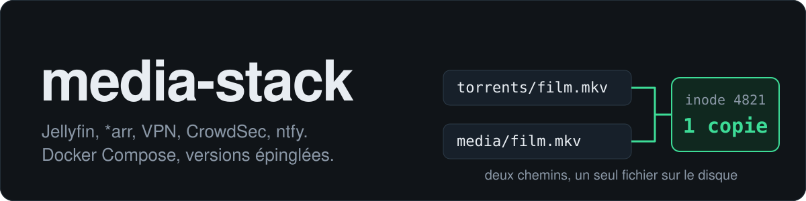

<p align="center">
  
</p>

<p align="center">
  <a href="LICENSE"></a>
  
  
</p>

Stack média auto-hébergée en Docker Compose : streaming, demandes, automatisation, VPN, reverse proxy, détection d'intrusion et supervision. Une unité compose par service, aucune image en `:latest`, un seul point de montage pour que les hardlinks fonctionnent.

C'est une base à adapter, pas une installation clé en main. La valeur du dépôt est dans la raison de chaque choix et dans les pièges documentés.

**[Ce qui tourne](#ce-qui-tourne)** · **[Démarrage](#démarrage)** · **[Installer avec un agent](#installer-avec-un-agent)** · **[Principes](#principes)** · **[Documentation](#documentation)**

## Ce qui tourne

| Rôle | Services |
|---|---|
| Streaming et demandes | Jellyfin, Seerr |
| Automatisation | Sonarr, Radarr, Prowlarr, Bazarr, Recyclarr, Cleanuparr |
| Téléchargement | qBittorrent derrière Gluetun (VPN, kill-switch), Flaresolverr |
| Accès | Nginx Proxy Manager, certificats wildcard Let's Encrypt |
| Sécurité | CrowdSec et bouncer pare-feu |
| Supervision | Gatus, Scrutiny, ntfy, Arcane |

Optionnels, présents dans `compose/` mais non déployés par défaut : `autobrr`, `wizarr`. Voir [docs/optionnel.md](docs/optionnel.md).

## Démarrage

```bash
git clone https://github.com/vkarcher/media-stack.git && cd media-stack
cp .env.example .env && $EDITOR .env
./install.sh
```

`install.sh` prépare l'arborescence, les réseaux Docker et les gabarits de secrets, puis vérifie que `media/` et `torrents/` partagent un système de fichiers. Il ne démarre rien. La suite, de zéro à Jellyfin en ligne : [QUICKSTART.md](QUICKSTART.md).

## Installer avec un agent

Un agent de code (Claude Code, Codex, etc.) peut dérouler l'installation de bout en bout. Le mode d'emploi, avec les points où il doit s'arrêter et demander à l'humain, est dans **[docs/agent-setup.md](docs/agent-setup.md)**. Il est résumé pour les agents dans [AGENTS.md](AGENTS.md).

## Principes

- **Seul le reverse proxy publie des ports.** Les autres services restent en `expose`.
- **Un compose par unité**, jamais un monolithe : on arrête un service sans toucher aux autres.
- **Un seul montage `/data`** pour tout ce qui déplace des fichiers. Deux montages, et Radarr copie au lieu de lier : [docs/hardlinks.md](docs/hardlinks.md).
- **Versions figées, mises à jour décidées.** Pas de `:latest`, pas de mise à jour automatique : un notificateur prévient, vous changez le tag.
- **Aucun secret dans un compose.** `.env` et `secrets/` sont exclus de Git, `.env.example` liste les clés attendues.

## Documentation

| Document | Contenu |
|---|---|
| [agent-setup.md](docs/agent-setup.md) | Installation pilotée par un agent |
| [hardlinks.md](docs/hardlinks.md) | Le piège n°1 et comment le vérifier |
| [architecture.md](docs/architecture.md) | Réseaux, nommage, découpage des compose |
| [reverse-proxy.md](docs/reverse-proxy.md) | Wildcards, DNS-01, sous-domaines privés |
| [securite.md](docs/securite.md) | CrowdSec, `DOCKER-USER`, ce qui bloque réellement |
| [notifications.md](docs/notifications.md) | ntfy, push mobile, brancher chaque service |
| [migration.md](docs/migration.md) | Reprendre une installation existante |
| [pieges.md](docs/pieges.md) | Tout ce qui a coûté du temps |
| [optionnel.md](docs/optionnel.md) | Services optionnels, et ceux à éviter |

<details>
<summary>Prérequis</summary>

- Un hôte Linux avec Docker et le plugin Compose
- Un nom de domaine dont vous gérez le DNS
- Un seul système de fichiers pour `media/` et `torrents/`
- Un abonnement VPN compatible [gluetun](https://github.com/qdm12/gluetun-wiki) pour le téléchargement
- 8 Go de RAM au minimum, 16 Go confortable. Le transcodage matériel (`/dev/dri`) est optionnel.

</details>

## Licence

[MIT](LICENSE)
